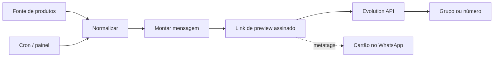

# 01 · Conceitos

## O que é a Evolution API

É um servidor open-source que conversa com o WhatsApp usando o protocolo do
WhatsApp Web (biblioteca Baileys). Você sobe a sua instância, conecta um número
lendo um QR code e passa a enviar mensagens por HTTP.

Ela **não** é oficial da Meta. Isso tem consequências (leia `docs/08`).

## O fluxo completo



## JID: o endereço no WhatsApp

| Tipo | Formato | Exemplo |
|---|---|---|
| Telefone | `DDI + DDD + número` | `5511999999999` |
| Grupo | número interno + `@g.us` | `120363000000000000@g.us` |

O JID do grupo é obtido na Evolution:

```bash
curl -H "apikey: SUA_CHAVE" \
  "http://localhost:8080/group/fetchAllGroups/SUA_INSTANCIA?getParticipants=false"
```

## Preview card

Quando você cola um link no WhatsApp, ele busca as metatags Open Graph da
página e monta um cartão com foto, título e descrição.

O problema: links curtos de marketplace redirecionam entre domínios e o motor
do WhatsApp não segue esse redirecionamento para montar o cartão. A solução do
kit é publicar uma página própria (`/o/:token`) que já entrega as metatags e
redireciona na hora. Detalhes em `docs/06`.

## Limites que importam

| Item | Limite prático |
|---|---|
| Texto de uma mensagem | 4096 caracteres |
| Intervalo entre mensagens | 3–5 segundos (evita spam) |
| Mensagens por minuto | poucas; não dispare em massa |
| Validade do link de preview | 7 dias (configurável) |

## Opt-in e etiqueta

- Só envie para grupos/canais **seus** ou onde você foi autorizado.
- Avise os participantes sobre o tipo e a frequência das mensagens.
- Não marque pessoas sem consentimento.
- Respeite pedidos de saída e nunca recrie o grupo para contornar.

## Risco de banimento

A integração não-oficial pode resultar em bloqueio do número. Reduza o risco:

- use um chip dedicado;
- mantenha intervalo entre envios;
- não envie a mesma mensagem para muitos contatos;
- não use listas compradas;
- tenha um plano B (outro número ou API oficial).

## Glossário

- **Instância**: um número conectado dentro da Evolution.
- **Manager**: interface web da Evolution (`/manager`).
- **Baileys**: biblioteca que implementa o protocolo do WhatsApp Web.
- **Open Graph**: metatags (`og:title`, `og:image`...) usadas para o cartão.
- **Claim**: reserva atômica de uma chave para evitar envio duplicado.
- **Provider**: adaptador de envio (Evolution, Meta Cloud API...).
